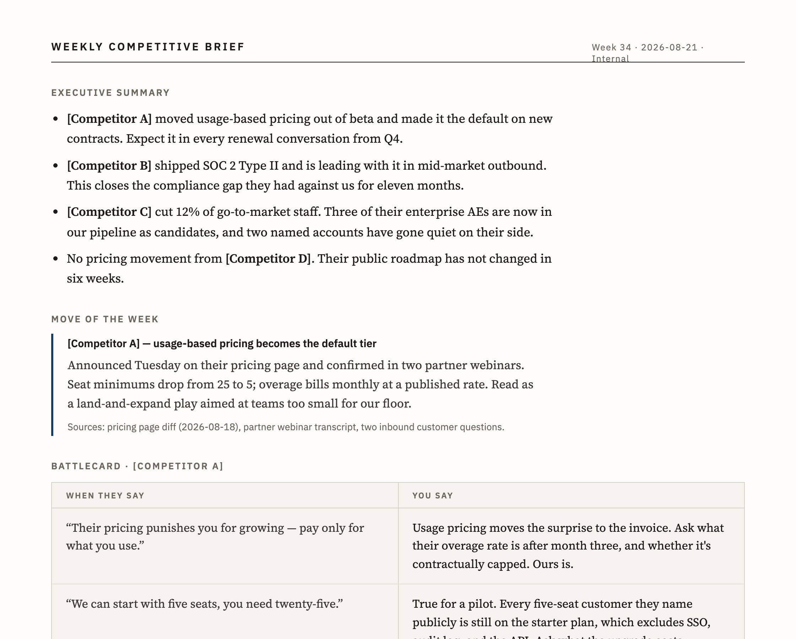

# competitive-intel

A [Claude Code](https://claude.ai/code) plugin that runs **autonomous competitive intelligence** for B2B teams. Name your competitors and it tracks them across LinkedIn, news, community forums, user reviews, job postings, and regulatory signals, then drafts an executive brief and per-competitor sales battlecards, critiques its own work against a quality bar, and holds everything for your sign-off before it sends.



> **Noncommercial use only (PolyForm Noncommercial 1.0.0).** This plugin is the work of Brittany Slay. Use, adapt, and share it for noncommercial purposes with attribution intact. Commercial use (reselling, white-labeling, or productizing it) requires a license from Brittany Slay. See [LICENSE.md](LICENSE.md).

Every run produces a dated executive brief and one sales battlecard per competitor. The brief reads like this:

```markdown
# Competitive Intelligence Brief - Week of [date]

## Executive Summary
- [Competitor A] shipped usage-based pricing; expect it in deals by Q3.
- [Competitor B] is hiring 4 enterprise AEs in the Northeast: they're moving upmarket.
- Review sentiment on [Competitor A] dipped on onboarding complaints; a wedge for us.

## Moves this week
**[Competitor A] - new pricing page**
Signal: LinkedIn post + pricing page diff. Implication: undercuts our Team tier.
Recommended action: add a per-seat comparison to the pricing objection battlecard.

## Opportunities & threats for us
- Gap we can exploit: [Competitor B] has no SOC 2 page. Lead with trust in that segment.
```

*Battlecards are one page each: how they position, where you win, the traps, and the exact rebuttals a rep can use live.*

> **Anonymized template.** The two config files ship as `*.example.json` describing a fictional company. Run `/intel-setup` and the plugin fills in your real versions from your website; they are git-ignored so they never get committed.

---

## What it does

- **Fans out to five specialist research agents** - LinkedIn, news + community forums, G2/Capterra reviews, job postings, and regulatory/industry signals - each turning one public source into structured JSON. A writer agent synthesizes them and a QA agent critiques the result.
- **Reads your market, not a hardcoded industry.** The community, review, and regulatory agents key off your own `company_context.json` (your communities, your buyer personas, the regulation that moves your category), so the same system works for analytics, fintech, safety, healthtech, or anything else.
- **Synthesizes one executive brief** with a week-over-week diff that surfaces exactly what changed since last week, framed from your company's angle.
- **Writes a sales battlecard per competitor** a rep can use live: how they position, where you win, the traps, and the rebuttals.
- **Vets its own work.** A QA pass checks every claim for a source, flags fabrication and voice problems, and sends targeted fixes back to the writers for one tightening pass before you ever see the draft.
- **Drafts and holds.** Interactive runs save the brief, show it to you, and wait for your `send`. Scheduled runs send unattended once the draft passes QA. A lightweight daily check only pings you when something scores at least 4/10.
- **Needs no paid scraping key.** Free search by default (DuckDuckGo), with an optional Brave key for higher-quality results. The only required credential is a Gmail App Password, and only for email delivery.

---

## Install

**Prerequisites:** [Claude Code](https://claude.ai/code), Node.js, and (for email delivery only) a Gmail account with an [App Password](https://myaccount.google.com/apppasswords).

### Option A - install as a plugin (recommended)

```
/plugin marketplace add brittanyslay/competitive-intel
/plugin install competitive-intel
```

Then set the delivery env vars (`GMAIL_USER`, `GMAIL_APP_PASSWORD`, optional `BRAVE_API_KEY`) in your shell so the bundled MCP server can send mail and search. See [GUIDE.md](GUIDE.md).

### Option B - clone and run

```bash
git clone https://github.com/brittanyslay/competitive-intel && cd competitive-intel
cd mcp/apify && npm install && cd ../..

export GMAIL_USER="you@gmail.com"
export GMAIL_APP_PASSWORD="xxxx xxxx xxxx xxxx"
# export BRAVE_API_KEY="..."   # optional, improves search quality

claude mcp add competitive-intel node "$(pwd)/mcp/apify/index.js" \
  -e GMAIL_USER=$GMAIL_USER -e GMAIL_APP_PASSWORD=$GMAIL_APP_PASSWORD
```

### Then, either way, configure it in one step

```
claude
> /intel-setup
```

`/intel-setup` asks you four short questions (your company and domain, two to five competitors, optionally how you win, and a delivery email), then researches your own site and each competitor and writes `company_context.json` and `competitors.json` for you. No copying example files, no hand-editing JSON.

```
> /run-intel
```

See **[GUIDE.md](GUIDE.md)** for full setup, customization, and scheduling.

---

## Example prompts

The `competitive-analysis` skill activates automatically when you ask competitor questions in plain language. Things people actually type:

- `track what my competitors are doing this week`
- `build me a competitive brief on Competitor A and Competitor B`
- `monitor Competitor A on LinkedIn and in the news`
- `write a sales battlecard against Competitor B`
- `what are my competitors hiring for right now?`
- `set up weekly competitive intel and email it to me`
- `watch competitor reviews on G2 and Capterra`
- `what is Competitor A doing in AI this quarter?`
- `any breaking news on my competitors today?`
- `where can we win against Competitor B in a live deal?`

You can also drive it explicitly:

```
/intel-setup                  # One-step intake: writes your config from a few answers
/run-intel                    # Full cycle, drafted, self-critiqued, held for your review
/run-intel email              # Full cycle, send once it passes QA (use on a schedule)
/run-intel focus:product      # LinkedIn + news only - fast product check
/run-intel focus:hiring       # Hiring tracker only
/run-intel focus:regulatory   # Regulatory radar only
/run-intel no-email           # Run everything, never email
/daily-alert                  # Manual breaking-news check
```

---

## What's inside

| File / component | What it does |
|---|---|
| `skills/competitive-analysis.md` | Auto-activates on competitor questions; orchestrates intake, research, QA, and the hold-for-review step |
| `commands/intel-setup.md` | `/intel-setup` - intake-first; researches your answers and writes both config files |
| `commands/run-intel.md` | `/run-intel` - full weekly pipeline, self-critiqued, drafted and held |
| `commands/daily-alert.md` | `/daily-alert` - lightweight daily breaking-news check |
| `agents/linkedin-researcher.md` | Reads competitor LinkedIn posts -> themes, product signals, tone |
| `agents/news-scanner.md` | News, press, blog + the communities in your context -> launches, partnerships, complaints |
| `agents/review-monitor.md` | G2, Capterra, SoftwareAdvice -> sentiment by your buyer personas and your openings |
| `agents/hiring-tracker.md` | Job posting analysis -> leading product signals, tech stack, expansion |
| `agents/regulatory-radar.md` | Regulatory + industry signals, keyed to your category -> what's coming and competitor reactions |
| `agents/brief-writer.md` | Synthesizes all agents -> executive brief with week-over-week diff |
| `agents/battlecard-writer.md` | Brief + reviews + hiring -> per-competitor sales battlecards |
| `agents/qa-reviewer.md` | Critiques the draft against a quality bar and returns targeted fixes for one tightening pass |
| `mcp/apify/index.js` | MCP server - `linkedin_posts`, `check_sitemap`, `crawl_website`, `google_search`, `send_email` |
| `scripts/weekly-run.sh` | Cron: weekly full brief (emails after QA) |
| `scripts/daily-alert.sh` | Cron: daily breaking-news check |
| `company_context.example.json` | Shape of `company_context.json` - your positioning, personas, regulatory focus, communities (git-ignored) |
| `competitors.example.json` | Shape of `competitors.json` - who to track (git-ignored) |

### Configuration

| Variable | Required | Description |
|---|---|---|
| `GMAIL_USER` | For email | Gmail address used to send the brief |
| `GMAIL_APP_PASSWORD` | For email | Gmail App Password - [generate here](https://myaccount.google.com/apppasswords) |
| `BRAVE_API_KEY` | No | [Brave Search API](https://brave.com/search/api) key - free tier, improves search over DuckDuckGo |

**No paid scraping key required.** Search uses DuckDuckGo by default; crawling uses native HTTP fetch; LinkedIn coverage is best-effort via search-indexed posts. Two files drive all quality, and `/intel-setup` drafts both for you:

- **`company_context.json`** - your positioning, differentiators, win/loss themes, ICP, buyer personas, regulatory focus, and communities. Injected into every brief and battlecard.
- **`competitors.json`** - who to track, plus a free-text `notes` field per competitor that gives the agents starting context.

### A note on ethics

This tool reads **publicly available** information: public posts, press, published reviews, public job listings. It does not scrape private data, bypass logins, or collect personal contact information. Keep it that way. See [PRIVACY.md](PRIVACY.md).

---

## License

Noncommercial use only (PolyForm Noncommercial 1.0.0). Commercial use requires a license from Brittany Slay. See [LICENSE.md](LICENSE.md).

---

Built by [Brittany Slay](https://brittanyslay.com), a B2B marketing leader who builds AI-native tools. More free Claude skills at [brittanyslay.com/skills](https://brittanyslay.com/skills). Want a competitive-intel program or an AI-native marketing function built for real? [Get in touch](https://brittanyslay.com/#contact).
